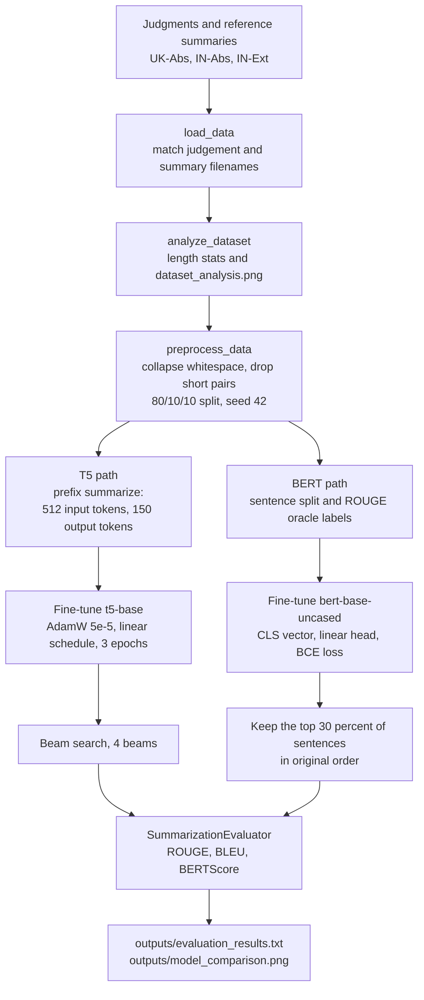

# Legal Document Summarization

Court judgments run to tens of thousands of words. This project builds two neural summaries of the same case and scores them against a human reference: a **T5** model that writes a new abstractive summary, and a **BERT** sentence ranker that extracts the sentences already in the judgment.

The corpus is the UK and Indian Supreme Court collection released with *Legal Case Document Summarization: Extractive and Abstractive Methods and their Evaluation* (AACL-IJCNLP 2022). The code is a PyTorch and Hugging Face pipeline: load paired judgments and summaries, clean and split them, fine-tune each model, and score the outputs with ROUGE, BLEU, and BERTScore.

**Author.** [Sydney Ani](https://github.com/sydneyani) — M.S., Engineering Data Science & AI, University of Houston. NVIDIA Deep Learning Institute certificates in Natural Language Processing and Retrieval-Augmented Generation. The T5 abstractive model is Sydney's. The BERT extractive ranker is credited in the source to Nicolas Osorio. The longer write-up is [`Report.html`](Report.html).

There is no notebook in this repository. Training and evaluation run from `main.py`.

## Problem

Legal readers need the holding, the governing rule, and the outcome of a case. A Supreme Court judgment is a poor place to find them quickly. In the analysis checked into this repo, a document averages about 30,000 characters and 190 sentences, and the paired summary is about one-fifth as long (compression ratio 0.2252). The summary still has to keep citations, statutory names, amounts, and the court's actual conclusion.

Two modeling choices answer that differently:

- **Extractive** summarization ranks sentences and keeps the originals. Citations and defined terms survive because the words are copied.
- **Abstractive** summarization generates new text. It can be shorter and more fluent, and it can also drop a citation or state a number that was not in the source.

This repository trains one model of each kind on the same pairs and compares them with the same metrics.

## Approach

### Abstractive model (T5)

`abstractive/t5_summarizer.py` fine-tunes Hugging Face `t5-base` (`T5ForConditionalGeneration`, about 220 million parameters) as a text-to-text task. Each document is prefixed with `summarize: `, truncated to **512** tokens, and paired with a reference summary truncated to **150** tokens. Training uses teacher forcing through the standard T5 label loss.

| Setting | Value in code |
| --- | --- |
| Checkpoint | `t5-base` (override with `--t5_model`) |
| Optimizer | AdamW, learning rate `5e-5` |
| Schedule | Linear decay, 0 warmup steps |
| Gradient clip | 1.0 |
| Epochs / batch size | 3 / 8 by default |
| Decoding | Beam search, 4 beams, early stopping |

`Report.html` lists a maximum input of 1,024 tokens and a maximum output of 256 tokens. `main.py` constructs `T5LegalSummarizer` with the class defaults, which are 512 and 150. The class defaults are the settings a run actually uses.

### Extractive model (BERT sentence ranker)

`extractive/bertsum_extractor.py` is a sentence-level extractive ranker built on `bert-base-uncased`. The class is named for Liu's BERTSum paper. Each sentence is encoded on its own, and a linear layer maps the `[CLS]` vector to one logit. Training treats that logit as a binary label. Inference ranks sentences by the logit and keeps a fixed fraction of them.

Oracle labels for training come from the reference summary. For every sentence the code averages ROUGE-1, ROUGE-2, and ROUGE-L F1 against the reference, then marks the top sentences positive. The count kept is `max(1, int(n_sentences * (len(summary) / len(document)) * 2))`. The loss is `BCEWithLogitsLoss`. AdamW uses learning rate `2e-5` on the classifier and `2e-6` on BERT (`learning_rate / 10`). At inference the model keeps the top 30 percent of sentences and restores their original order.

Calling the class directly:

```python
from extractive.bertsum_extractor import BERTSumExtractor

extractor = BERTSumExtractor(model_name="bert-base-uncased")
train_docs, train_labels = extractor.prepare_training_data(train_df)
val_docs, val_labels = extractor.prepare_training_data(val_df)
extractor.train(
    train_docs, train_labels, val_docs, val_labels, epochs=3, batch_size=8
)
print(extractor.generate_extractive_summary(document, ratio=0.3))
```

Inside `main()`, `bertsum_extractor` is set to `None` and left there. A `python main.py --mode bertsum` or `--mode both` run therefore trains and scores T5 only. The evaluation and plotting code already accepts the extractor once an instance is passed in. Wiring that constructor into `main()` is the missing orchestration step. The `--interactive` path, which runs after `main()` returns, does construct `BERTSumExtractor`.

The matching T5 call:

```python
from abstractive.t5_summarizer import T5LegalSummarizer

summarizer = T5LegalSummarizer(model_name="t5-base")
train_loader, val_loader, _ = summarizer.prepare_data(
    train_df, val_df, test_df, batch_size=8
)
summarizer.fine_tune(train_loader, val_loader, epochs=3, learning_rate=5e-5)
print(summarizer.generate_summary(document))
```

### Evaluation

`utilities/evaluation.py` (`SummarizationEvaluator`) scores a test frame of `document` and `summary` columns.

| Metric | Implementation |
| --- | --- |
| ROUGE-1, ROUGE-2, ROUGE-L | `rouge-score`, Porter stemming on. Precision, recall, and F1, macro-averaged over pairs. |
| BLEU-1 through BLEU-4 | NLTK `sentence_bleu` with smoothing method 1. BLEU-4 uses uniform weights `(0.25, 0.25, 0.25, 0.25)`. |
| BERTScore | `bert-score`, English, `rescale_with_baseline=True`. Precision, recall, and F1. |

Empty predictions are dropped from the average. The evaluator writes nothing itself. `main.py` writes `outputs/evaluation_results.txt` and, when both models returned scores, `outputs/model_comparison.png`.

## Pipeline



`torch.manual_seed(42)` and `np.random.seed(42)` are set in `main.py`. The split uses `random_state=42`. The sample shown at the end of a run uses the unseeded `random` module, so that single example index changes between processes.

CUDA is used when `torch.cuda.is_available()` is true. Otherwise training runs on CPU.

## Dataset

The raw text is not in this repository. Download the release from [Zenodo record 7152317](https://zenodo.org/records/7152317) and place the three folders at the repository root. `dataset/README.md` describes the layout and the citation.

Published sizes, as recorded in `dataset/README.md`:

| Corpus | Documents | What it contains |
| --- | ---: | --- |
| IN-Abs | 7,130 | Indian Supreme Court judgments with abstractive summaries. 7,030 official train pairs and 100 official test pairs. Source: LII of India. |
| UK-Abs | 793 | UK Supreme Court judgments with abstractive summaries. 693 official train pairs and 100 official test pairs. |
| IN-Ext | 50 | Indian Supreme Court judgments with extractive summaries from two law experts (A1 and A2), in full and segment-wise forms. |

The project analysis (`dataset/README.md` and Table I of `Report.html`) reports a combined set of **7,823** document-summary pairs. Adding the three published sizes gives 7,973. The loader explains part of the gap: `load_data()` keeps a pair only when a `judgement/` directory and a `summary/` directory share a parent and contain the same filename. Nested paths such as `IN-Ext/summary/full/A1/` are never matched. The 7,823 figure is the authors' reported analysis. This checkout does not recompute it, because the corpus files are not stored here.

| Statistic | Reported value |
| --- | --- |
| Pairs in the project analysis | 7,823 |
| Mean document length | 30,339.68 characters, 190.04 sentences |
| Mean summary length | 4,996.06 characters, 32.91 sentences |
| Mean compression (summary characters / document characters) | 0.2252 |
| 99th percentile document length | 190,528.94 characters |
| 99th percentile summary length | 23,997.72 characters |
| 99th percentile document sentences | 1,099.12 |
| 99th percentile summary sentences | 149.00 |
| Train / validation / test in the report | 6,256 / 782 / 783 |

`preprocess_data()` collapses whitespace and drops pairs whose document is shorter than 50 characters or whose summary is shorter than 10 characters, then splits 80/10/10 with `random_state=42`. On 7,821 rows that split is exactly 6,256 / 782 / 783, the sizes in the report. The reported combined total is 7,823, two rows above the count that yields those sizes. The length filter is a plausible source of that two-row gap. The corpus is not in this checkout, so the gap cannot be confirmed by re-running the loader. The split pools every loaded pair. Official IN-Abs and UK-Abs test documents of 100 cases each can fall into the training set.

`analyze_dataset()` writes length histograms truncated at the 99th percentile. The figure checked in here is that plot:


### Citation

```bibtex
@inproceedings{bhattacharya2021,
  title={Legal Case Document Summarization: Extractive and Abstractive Methods and their Evaluation},
  author={Shukla, Abhay and Bhattacharya, Paheli and Poddar, Soham and Mukherjee, Rajdeep and Ghosh, Kripabandhu and Goyal, Pawan and Ghosh, Saptarshi},
  booktitle={Proceedings of the 2nd Conference of the Asia-Pacific Chapter of the Association for Computational Linguistics and the 12th International Joint Conference on Natural Language Processing},
  year={2022}
}
```

## Results

The scores below are Table II of [`Report.html`](Report.html). This repository does not contain `outputs/evaluation_results.txt`, saved checkpoints, or a rerun log. Treat the table as the project's reported test-set comparison, on the 783-example test split named in the report.

| Metric | T5 abstractive | BERT extractive |
| --- | ---: | ---: |
| ROUGE-1 F1 | 0.2173 | 0.3142 |
| ROUGE-2 F1 | 0.1079 | 0.1654 |
| ROUGE-L F1 | 0.1450 | 0.2475 |
| BLEU-1 | 0.0361 | 0.1028 |
| BLEU-4 | 0.0120 | 0.0342 |
| BERTScore F1 | 0.0095 | 0.1125 |

On every reported metric the extractive ranker scores higher. The gap is largest on ROUGE-1 F1 (0.3142 vs. 0.2173) and ROUGE-L F1 (0.2475 vs. 0.1450). That pattern fits this task: reference summaries of judgments often reuse the court's own sentences, and an extractor that copies those sentences collects n-gram overlap that a paraphraser has to earn back. The T5 path also sees only the first 512 tokens of a document whose mean length is about 190 sentences, so most of the judgment never reaches the abstractive model.

BERTScore in the code is baseline-rescaled (`rescale_with_baseline=True`). Rescaled scores sit near zero more often than raw cosine BERTScore, which is the right context for the 0.0095 and 0.1125 figures in the report.

`Report.html` also includes one qualitative example (an Indian income-tax appeal) and discusses factual drift in the abstractive output, citation loss, and both models attending to the start and end of long judgments. Those observations are in the report. They are not backed by a checked-in predictions file.

### Reproduce the table

From the repository root, with the three corpus folders in place:

```bash
python main.py --mode both --epochs 3 --batch_size 8 --output_dir outputs --save_models
```

That command fine-tunes T5, writes `outputs/t5_model.pt` and `outputs/evaluation_results.txt`, and prints ROUGE, BLEU, and BERTScore. The side-by-side bar chart is written only after both models have produced a score dictionary. Until `main.py` constructs `BERTSumExtractor`, the extractive column stays empty. Train and score the extractor with the snippet in the approach section, then pass the fitted instance to `SummarizationEvaluator.evaluate_model(..., extractive=True)`.

`--eval_only` skips fine-tuning and scores the Hugging Face initialization currently in memory. After `main()` returns, `--interactive` constructs both classes again and loads `outputs/t5_model.pt` or `outputs/bertsum_model.pt` when that file exists. With no checkpoint, the extractive linear head is the randomly initialized layer created in `BERTSumExtractor.__init__`.

## Setup and running

Python 3.10 or newer. A CUDA GPU is optional. `t5-base` and `bert-base-uncased` download from Hugging Face on first use.

```bash
python -m venv .venv
source .venv/bin/activate
pip install -r requirements.txt
python -c "import nltk; nltk.download('punkt'); nltk.download('punkt_tab')"
```

Place `UK-Abs/`, `IN-Abs/`, and `IN-Ext/` in the repository root, then:

```bash
python main.py --mode t5 --epochs 3 --batch_size 8 --save_models
```

`run_project.py` is a wrapper. It forwards `--install`, `--sample_data`, `--mode`, `--epochs`, `--eval_only`, and `--interactive`. Batch size, model names, the output directory, and `--save_models` are flags of `main.py` only.

```bash
python run_project.py --install --mode t5 --epochs 3
```

Useful `main.py` flags:

| Flag | Default | Role |
| --- | --- | --- |
| `--mode` | `both` | `t5`, `bertsum`, or `both` |
| `--epochs` | `3` | Fine-tuning epochs |
| `--batch_size` | `8` | Training batch size. Lower this if the GPU runs out of memory. |
| `--t5_model` | `t5-base` | Hugging Face T5 name |
| `--bert_model` | `bert-base-uncased` | Hugging Face BERT name |
| `--output_dir` | `outputs` | Metrics, plots, and checkpoints |
| `--save_models` | off | Write `t5_model.pt` and, when the extractor trains, `bertsum_model.pt` |
| `--eval_only` | off | Skip the training block and score the loaded initialization |
| `--sample_data` | off | Use the three built-in toy judgments |
| `--interactive` | off | After the run, read pasted text and summarize it |

`--sample_data` builds a 3-row frame. The 80/10/10 split then tries to cut a validation set from a single remaining row, and scikit-learn raises `ValueError` because the training side of that cut is empty. Use the Zenodo corpus for a real run.

The top-level parser in `main.py` only advertises `--interactive`. The training flags above are parsed inside `main()`.

`install_dependencies.py` installs the same libraries with pip and downloads the NLTK `punkt` tokenizer. Prefer `pip install -r requirements.txt`, which also installs `protobuf` for the T5 tokenizer stack.

## Project structure

```
.
├── abstractive/
│   └── t5_summarizer.py        # T5 fine-tuning and beam-search summaries
├── extractive/
│   └── bertsum_extractor.py    # BERT sentence ranker and ROUGE oracles
├── dataset/
│   ├── data_utils.py           # Load, clean, split, and plot the corpus
│   └── README.md               # Corpus layout and citation
├── utilities/
│   ├── evaluation.py           # ROUGE, BLEU, and BERTScore
│   └── requirements.txt        # Same pins as the root requirements file
├── main.py                     # Train and evaluate from the command line
├── run_project.py              # Optional installer plus a call to main.py
├── install_dependencies.py     # Direct pip installer
├── dataset_analysis.png        # Length histograms at the 99th percentile
├── Report.html                 # Project report, including Table I and Table II
├── requirements.txt
└── LICENSE
```

`outputs/` is created on a run and is gitignored. Model weights (`*.pt`, `*.safetensors`) and the three corpus folders are gitignored as well.

## Limitations

- **Context length.** T5 reads 512 tokens of a document that averages about 190 sentences. The report describes a sliding window. The code truncates.
- **Extractive orchestration.** `BERTSumExtractor` is implemented and unconnected in `main.py`, so the default entry point does not train or score it.
- **Extractive architecture.** The ranker classifies sentences independently. A full BERTSum model also models relationships between sentences.
- **Oracle overlap.** Positive extractive labels are the sentences with the highest ROUGE against the reference. That training signal favors the same n-gram overlap the test metrics reward.
- **Split.** Pairs are shuffled with a random 80/10/10 split. Official IN-Abs and UK-Abs test documents can land in training, so the reported numbers are not a comparison against the AACL paper's published split.
- **Loader coverage.** Only same-folder, same-filename judgment/summary pairs are read. The two-expert and segment-wise IN-Ext files live one directory deeper.
- **Metrics.** ROUGE, BLEU, and BERTScore measure textual similarity. They do not check that a holding, a citation, or an amount is legally correct. Baseline-rescaled BERTScore is not comparable to an unscaled BERTScore number from another paper.
- **Reproducibility artifacts.** Checkpoints, prediction files, and `outputs/evaluation_results.txt` are not in the tree. The score table exists in `Report.html`.
- **Toy data.** `--sample_data` cannot pass the current splitter.
- **Runtime installs.** The T5 initializer and the evaluator try to `pip install` missing packages during a run. Install from `requirements.txt` first so a training job does not depend on that side path.

## Future work

- Construct `BERTSumExtractor` inside `main.py` so `--mode both` trains, scores, and plots the two models in one process, and load saved weights on `--eval_only`.
- Give the abstractive model a long context: a sliding window with a merge step, or a long-context encoder, so the middle of a judgment is visible.
- Continue pretraining on legal text, then fine-tune, so citations and terms of art move less under paraphrasing.
- Run an extractive-then-abstractive pipeline: the ranker selects a short evidence set, and T5 writes the summary from those sentences only.
- Train and test on the official IN-Abs and UK-Abs splits, and score IN-Ext against each expert separately.
- Add a legal error check beside ROUGE: citation presence, party names, and numeric amounts in the system summary against the source judgment.
- Replace the 3-row toy frame with a splitter that keeps at least one row in every partition, so a new checkout can smoke-test the loop before downloading the corpus.

## License

[MIT](LICENSE). Copyright (c) 2025 Sydney Ani and contributors.
