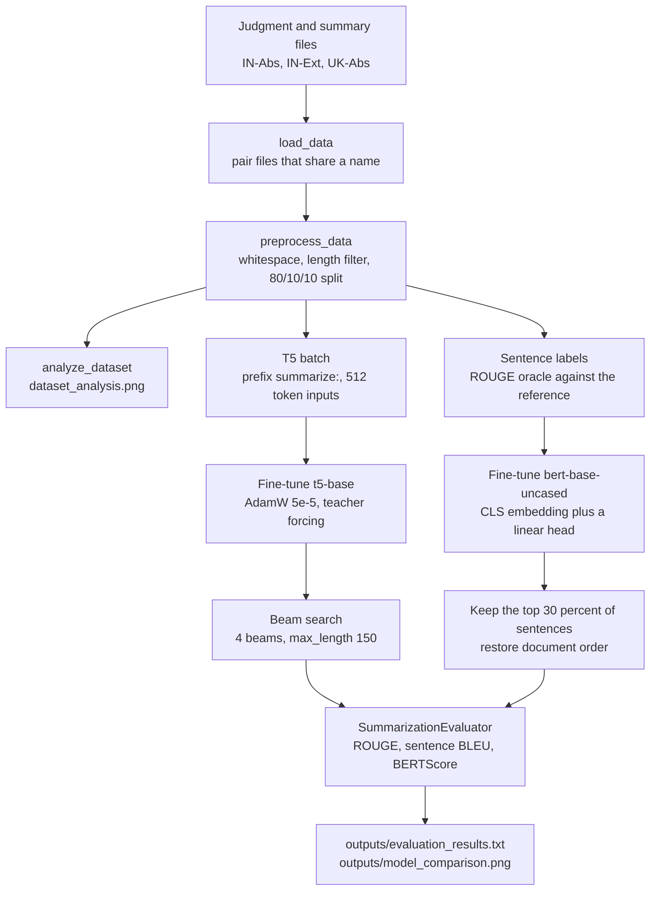
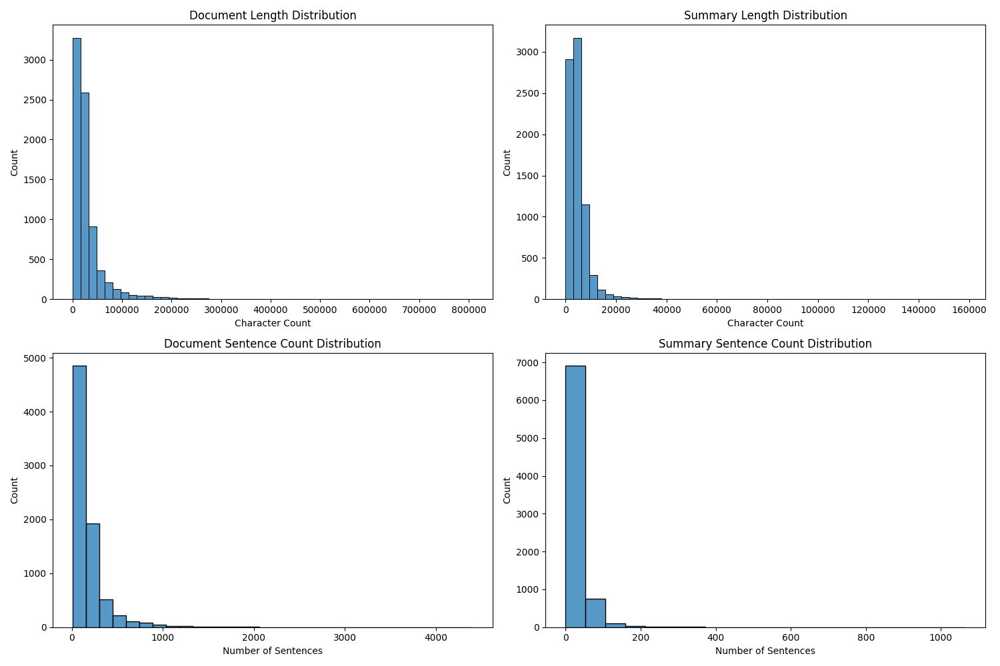

# Legal Document Summarization

Extractive and abstractive summarization of Supreme Court judgments. A T5 model writes a new summary. A BERT sentence ranker selects the sentences already in the opinion. Both are scored against the reference summaries with ROUGE, sentence BLEU, and BERTScore.

Court opinions in this corpus average about 30,000 characters. The useful part of a case — the holding, the cited statute, the remedy — is a small fraction of that text, and a summary that paraphrases a citation or a damages figure is wrong in a way that matters. This repository is a complete training and evaluation pipeline for that problem: load the public Indian and UK case corpus, fine-tune both models, and write a side-by-side metric report.

**Author:** Sydney Ani — M.S. Engineering Data Science & AI, University of Houston. NVIDIA Deep Learning Institute certificates in Natural Language Processing and Retrieval-Augmented Generation. Abstractive model in `abstractive/t5_summarizer.py`.

**Extractive model:** Nicolas Osorio — `extractive/bertsum_extractor.py`.

The longer write-up is [`Report.html`](Report.html). Raw judgments are not in this repository.

## Problem

Legal summarization is a compression task with a correctness constraint.

- Opinions are long, formulaic, and full of citations that have to survive unchanged.
- A usable summary is much shorter than the source. On the recorded analysis below, summary characters are about 0.23 of document characters.
- Extractive output keeps the court's wording, so statutory names and holdings stay intact. It also keeps surrounding sentences the ranker happened to score highly.
- Abstractive output can drop boilerplate and join facts that sit far apart. It can also invent a date, a party, or an amount.

The pipeline trains one model of each kind on the same splits and scores them with the same metrics.

## Approach

| | Abstractive | Extractive |
| --- | --- | --- |
| Code | `T5LegalSummarizer` in `abstractive/t5_summarizer.py` | `BERTSumExtractor` in `extractive/bertsum_extractor.py` |
| Checkpoint | `t5-base` | `bert-base-uncased` |
| Summary | Text decoded from the decoder | Sentences copied from the opinion, in their original order |
| Supervision | Teacher forcing. The decoder is trained with the token cross-entropy of the reference summary. | A ROUGE oracle. Each sentence is labeled positive when it is among the sentences with the highest mean of ROUGE-1, ROUGE-2, and ROUGE-L F1 against the reference. The number of positives is `max(1, floor(sentences × summary_ratio × 2))`. |
| Encoder input | The string `summarize: ` plus the opinion, truncated to 512 tokens | Each sentence is encoded on its own and truncated to 512 tokens. The classifier reads the `[CLS]` embedding. |
| Objective and optimizer | AdamW at `5e-5`, linear decay, no warmup, gradient clip `1.0` | `BCEWithLogitsLoss`. AdamW at `2e-5` on the classifier and `2e-6` on BERT (`learning_rate / 10`). |
| Decoding | Beam search, 4 beams, `max_length` 150 | Top `floor(0.3 × sentences)` sentences, at least one |
| Defaults | 3 epochs, batch size 8 | 3 epochs, batch size 8 |

The extractive class follows the BERTSum setup of scoring sentences with BERT and a classification head (Liu and Lapata, 2019). The head in this repository is a single linear layer on `[CLS]`. There is no inter-sentence Transformer and no interval segment embedding.

`main.py` is the entrypoint: load, profile, split, train the selected model or models, generate summaries on the test split, and write metrics. `utilities/evaluation.py` is the shared scorer.

## Pipeline



## Dataset

The corpus is the one released with Shukla, Bhattacharya, et al., *Legal Case Document Summarization: Extractive and Abstractive Methods and their Evaluation*, AACL-IJCNLP 2022. Download it from [Zenodo record 7152317](https://zenodo.org/record/7152317). Place the three top-level folders at the repository root. They are listed in `.gitignore`.

| Collection | What it contains | Published size |
| --- | --- | --- |
| IN-Abs | Indian Supreme Court judgments with abstractive summaries, from [LII of India](http://www.liiofindia.org/in/cases/cen/INSC/) | 7,130 pairs: 7,030 train and 100 test |
| IN-Ext | Indian Supreme Court judgments with extractive summaries by two law experts, full and segment-wise | 50 judgments |
| UK-Abs | UK Supreme Court judgments with abstractive summaries, from the [UK Supreme Court](https://www.supremecourt.uk/decided-cases/) | 793 pairs: 693 train and 100 test |

Those three releases sum to 7,973 pairs. The analysis recorded in this repository uses **7,823** pairs. The raw files and the log that produced 7,823 are not checked in, so the 150-pair difference cannot be recovered from this tree. Details of the folder layout are in [`dataset/README.md`](dataset/README.md).

`load_data()` walks `UK-Abs/`, `IN-Ext/`, and `IN-Abs/` and pairs files that share a filename and sit **directly** inside sibling `judgement/` and `summary/` directories. That matches the flat IN-Abs layout and the flat UK-Abs training layout. Nested summaries (`IN-Ext/summary/full/A1`, `summary/segment-wise/`, and the UK test `summary/full/` tree) are not paired.

`preprocess_data()` collapses whitespace, drops documents of 50 characters or fewer and summaries of 10 characters or fewer, and splits the rest 80% / 10% / 10% with `random_state=42`. On a frame of 7,823 rows that call returns 6,258 train, 782 validation, and 783 test. The write-up lists 6,256 / 782 / 783, which is the same call on 7,821 rows. A two-row drop from the length filter would explain the gap. The raw frame is not in the repository, so that explanation stays unchecked.

### Recorded corpus profile

These figures are the project's recorded analysis. The same character, sentence, and compression figures are in [`dataset/README.md`](dataset/README.md) and in Table I of [`Report.html`](Report.html). The 99th percentiles are Table I of the write-up. [`dataset_analysis.png`](dataset_analysis.png) is the matching histogram, with each axis cut at the 99th percentile.

| Metric | Value |
| --- | ---: |
| Pairs in the recorded analysis | 7,823 |
| Mean document length | 30,339.68 characters |
| Mean summary length | 4,996.06 characters |
| Mean document length | 190.04 sentences |
| Mean summary length | 32.91 sentences |
| Mean compression (summary characters / document characters) | 0.2252 |
| 99th percentile document length | 190,528.94 characters |
| 99th percentile summary length | 23,997.72 characters |
| 99th percentile document length | 1,099.12 sentences |
| 99th percentile summary length | 149.00 sentences |



A mean opinion of about 190 sentences does not fit in a 512-token T5 window. Most of each judgment is truncated before the abstractive model sees it.

## Results

### Scores recorded in the write-up

`outputs/` is not part of this repository. There is no `evaluation_results.txt`, no `model_comparison.png`, and no saved checkpoint here. The table below is Table II of [`Report.html`](Report.html), copied from that file. It was not recomputed while preparing this README.

The write-up describes T5 with a 1,024-token input and a 256-token output. The class that runs, `T5LegalSummarizer`, defaults to **512** and **150**. Read the table as the authors' recorded figures, and read the code for the limits a new run will use.

| Metric | T5 abstractive | BERTSUM extractive |
| --- | ---: | ---: |
| ROUGE-1 F1 | 0.2173 | 0.3142 |
| ROUGE-2 F1 | 0.1079 | 0.1654 |
| ROUGE-L F1 | 0.1450 | 0.2475 |
| BLEU-1 | 0.0361 | 0.1028 |
| BLEU-4 | 0.0120 | 0.0342 |
| BERTScore F1 | 0.0095 | 0.1125 |

The write-up's comparison is that the extractive model is higher on every one of these six metrics. In the legal setting that is a plausible shape of result: reference summaries quote the opinion, and an extractive model is rewarded for copying those sentences. It is also the shape ROUGE produces when the abstractive model is truncated to the first 512 tokens of a 30,000-character opinion.

### How a new run is scored

`SummarizationEvaluator` in `utilities/evaluation.py` scores every test pair and writes `outputs/evaluation_results.txt`. When both models run, `main.py` also writes `outputs/model_comparison.png`.

| Metric | Implementation |
| --- | --- |
| ROUGE-1, ROUGE-2, ROUGE-L | `rouge_score.RougeScorer` with stemming. Precision, recall, and F1 are averaged over pairs. The log prints F1. |
| BLEU-1, BLEU-2, BLEU-3, BLEU-4 | `nltk.translate.bleu_score.sentence_bleu` against one reference, smoothing method 1, then the mean over pairs. Weights are `(1, 0, 0, 0)`, `(0.5, 0.5, 0, 0)`, `(0.33, 0.33, 0.33, 0)`, and `(0.25, 0.25, 0.25, 0.25)`. |
| BERTScore | `bert_score.BERTScorer(lang="en", rescale_with_baseline=True)`. Mean precision, recall, and F1. Baseline rescaling can put a score near zero when the summary is far from the reference in embedding space. |

ROUGE and BLEU measure lexical overlap. They move up when the model repeats the reference and they stay quiet about whether a holding was stated correctly. BERTScore is the semantic check in this pipeline. None of the three checks a citation, a party name, or a monetary amount against the source opinion.

`--eval_only` skips training and scores the weights currently in memory. It does not load `outputs/t5_model.pt` or `outputs/bertsum_model.pt`. Those files are loaded only on the `--interactive` path. A fresh extractive model has a randomly initialized classification head, so an `--eval_only` run without a loaded checkpoint is a baseline, not a test of a trained ranker.

## Setup and running

Python 3.8 or newer. The first real run downloads `t5-base` and `bert-base-uncased` from Hugging Face. Each checkpoint is hundreds of megabytes. Fine-tuning on the full corpus needs a GPU. CPU is only practical for a handful of opinions.

```bash
git clone https://github.com/sydneyani/NLP-Legal-Text-AI-Summarization-Model.git
cd NLP-Legal-Text-AI-Summarization-Model

python -m venv .venv
source .venv/bin/activate
pip install -r requirements.txt

python -c "import nltk; nltk.download('punkt'); nltk.download('punkt_tab')"
```

Download the Zenodo archive and unzip it so the repository root contains `IN-Abs/`, `IN-Ext/`, and `UK-Abs/`. Then:

```bash
python main.py --mode both --epochs 3 --batch_size 8 --save_models
```

That writes `outputs/evaluation_results.txt`, and `outputs/model_comparison.png` when both models finish. With `--save_models` it also writes `outputs/t5_model.pt` and `outputs/bertsum_model.pt`.

| Command | What it runs |
| --- | --- |
| `python main.py --mode t5 --epochs 3` | Abstractive model only |
| `python main.py --mode bertsum --epochs 3` | Extractive model only |
| `python main.py --sample_data --epochs 1 --batch_size 2` | Three built-in demo opinions, reused as train, validation, and test |
| `python main.py --eval_only --mode both` | Score the in-memory weights. Does not load a checkpoint. |
| `python main.py --save_models --interactive` | Train, then type an opinion and print both summaries |
| `python run_project.py --install --mode both --epochs 3` | Run `install_dependencies.py`, then `main.py` |

`run_project.py` forwards `--mode`, `--epochs`, `--sample_data`, `--eval_only`, and `--interactive`. Batch size, checkpoint name, and output directory are flags on `main.py`:

| Flag | Default | Role |
| --- | --- | --- |
| `--mode` | `both` | `t5`, `bertsum`, or `both` |
| `--epochs` | `3` | Fine-tuning epochs |
| `--batch_size` | `8` | Batch size for both trainers |
| `--t5_model` | `t5-base` | Hugging Face T5 checkpoint |
| `--bert_model` | `bert-base-uncased` | Hugging Face BERT checkpoint |
| `--output_dir` | `outputs` | Metrics, plot, and checkpoints |
| `--sample_data` | off | Use the three opinions embedded in `main.py` |
| `--eval_only` | off | Skip `fine_tune` and `train` |
| `--save_models` | off | Write state dicts under `--output_dir` |
| `--interactive` | off | After the run, read an opinion from stdin |

The three-row sample is too small for an 80/10/10 split. `preprocess_data()` detects fewer than six rows and reuses them for every split, so `--sample_data` can execute the training loop. The downloaded checkpoints still have to be fetched, and the loss on three rows is a smoke test of the wiring.

`install_dependencies.py` installs the same packages and the NLTK `punkt` tokenizer. `pip install -r requirements.txt` is the setup path this README uses.

## Project structure

```
.
├── main.py                         # Train, generate, evaluate, optional interactive demo
├── run_project.py                  # Optional installer-then-train wrapper
├── install_dependencies.py         # Pip installer used by run_project.py --install
├── requirements.txt                # Runtime dependencies
├── dataset_analysis.png            # Length histograms from the recorded analysis
├── Report.html                     # Project write-up, including Table I and Table II
├── abstractive/
│   └── t5_summarizer.py            # T5 dataset, fine-tune, beam search
├── extractive/
│   └── bertsum_extractor.py        # ROUGE oracle, BERT sentence ranker
├── dataset/
│   ├── data_utils.py               # Load, clean, split, profile
│   └── README.md                   # Corpus layout and citation
└── utilities/
    └── evaluation.py               # ROUGE, BLEU, BERTScore
```

`outputs/` is created on a run and is gitignored.

## Limitations

- **Context window.** T5 reads 512 tokens of an opinion whose recorded mean length is 30,339.68 characters. Tokens past that cutoff never enter the encoder. The extractive model scores every sentence, and each sentence is itself truncated at 512 tokens.
- **Extractive head.** Sentence scores are independent. Nothing in the ranker models the order of arguments, the difference between facts and holding, or redundancy between selected sentences. The 30% keep-ratio is also higher than the recorded compression ratio of 0.2252, so extractive summaries run long relative to the references.
- **Oracle supervision.** Extractive labels are ROUGE overlap with the reference summary. The ranker is trained to find sentences that already look like the reference, which is a favorable setup for ROUGE at test time.
- **Nested summaries.** Expert summaries under `summary/full/` and `summary/segment-wise/` are invisible to `load_data()`.
- **Lexical metrics.** ROUGE and sentence BLEU do not check that a party, a statute, or an amount matches the opinion. BLEU-3 is accumulated with weights `(0.33, 0.33, 0.33, 0)`, which sum to 0.99.
- **Checkpoint loading.** `--eval_only` does not read the files written by `--save_models`.
- **Write-up versus code.** Table II in `Report.html` is the recorded comparison. The token limits named in that write-up are 1,024 and 256. The defaults in code are 512 and 150.
- **Runtime installs.** `T5LegalSummarizer` and `SummarizationEvaluator` call `pip` if SentencePiece or `bert-score` is missing. Install from `requirements.txt` first so training does not depend on a network install mid-run.

## Future work

- Replace the 512-token cutoff with a long-context encoder, or with an explicit segment-and-merge pass, so the middle of an opinion is visible.
- Load both expert summaries in IN-Ext and the nested UK test summaries, and report agreement between experts separately from agreement with the abstractive reference.
- Add the inter-sentence encoder from BERTSum, and a redundancy penalty, so the selected sentences cover the holding once.
- Score factual consistency of parties, citations, and amounts against the source opinion, alongside ROUGE.
- Continue pretraining on legal text, or start from a legal checkpoint, before the summarization fine-tune.
- Generate the abstractive summary from the sentences the ranker already selected, so citations stay verbatim and the model only compresses what remains.
- Retrieve the cited cases and condition the summary on those passages. The training code here is supervised summarization only.

## Citation

If you use the corpus, cite the paper that released it:

```bibtex
@inproceedings{bhattacharya2021,
  title={Legal Case Document Summarization: Extractive and Abstractive Methods and their Evaluation},
  author={Shukla, Abhay and Bhattacharya, Paheli and Poddar, Soham and Mukherjee, Rajdeep and Ghosh, Kripabandhu and Goyal, Pawan and Ghosh, Saptarshi},
  booktitle={The 2nd Conference of the Asia-Pacific Chapter of the Association for Computational Linguistics and the 12th International Joint Conference on Natural Language Processing},
  year={2022}
}
```

Models used by this code: Raffel et al., *Exploring the Limits of Transfer Learning with a Unified Text-to-Text Transformer*, JMLR 2020 (T5); Devlin et al., *BERT: Pre-training of Deep Bidirectional Transformers*, NAACL 2019; Liu and Lapata, *Text Summarization with Pretrained Encoders*, EMNLP 2019 (BERTSum).

## License

[MIT](LICENSE). Copyright (c) 2025 Sydney Ani.
